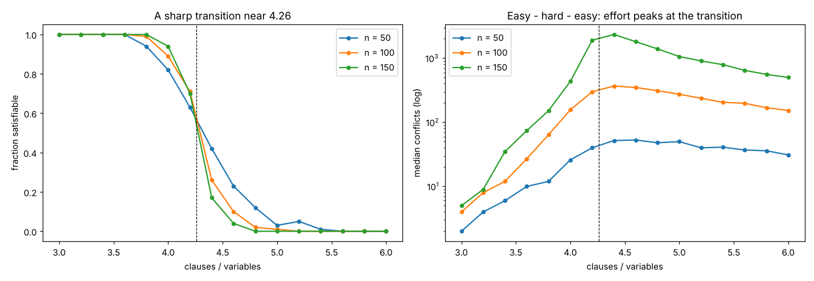
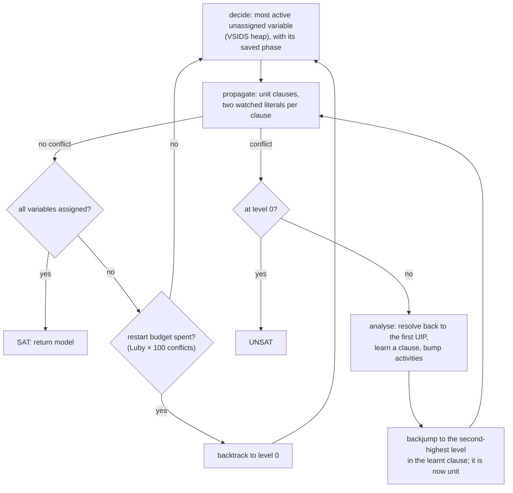

# cdcl-sat

A conflict-driven clause-learning (CDCL) SAT solver in OCaml. It is the modern descendant of DPLL,
with the core techniques used by production solvers such as MiniSat: two-watched-literal
propagation, first-UIP clause learning with non-chronological backjumping, VSIDS branching, phase
saving and Luby restarts.



The solver reproduces the random 3-SAT **phase transition**. Formulas switch from almost always
satisfiable to almost never as the clause-to-variable ratio crosses about 4.26, the switch sharpens
as n grows, and solver effort peaks at the threshold. 100 formulas per point, from
`bench/phase_transition.exe`.

## The CDCL loop



- **Two watched literals.** A clause is only visited when one of its two watched literals becomes
  false. Most assignments touch no clause at all, and backtracking needs no clause updates.
- **First-UIP learning.** The conflict is resolved with the reasons of current-level literals, walking
  the trail backwards, until one current-level literal is left: the *unique implication point*.
  The learnt clause blocks this conflict, and every assignment that leads to it, for good.
- **Non-chronological backjumping.** After learning, the solver jumps straight to the level where the
  new clause becomes unit, skipping irrelevant decisions in between.
- **VSIDS.** Variables in recent conflicts get their activity bumped. The increment grows by 1/0.95
  per conflict, which decays all old activity, and a binary heap keeps "most active" at O(log n).
- **Phase saving** reuses each variable's last polarity. **Luby restarts** (1, 1, 2, 1, 1, 2, 4, …
  × 100 conflicts) escape unlucky early decisions.

## Tests

| test | what it checks |
|---|---|
| agrees with brute force | 600 random formulas (8–14 variables, both sides of the threshold): same SAT/UNSAT answer as checking all 2ⁿ assignments, and every model is verified |
| pigeonhole | 8 pigeons in 7 holes is UNSAT (exponentially hard for pure resolution); 7 in 7 is SAT |
| N-queens | 8 queens is SAT with a verified placement; 2 and 3 queens are UNSAT |
| Sudoku | a 50-blank puzzle (729 variables) is solved, with every row, column, box and given verified |
| DIMACS | comments, clauses split across lines, and the `%` terminator used by SATLIB files |
| threshold instance | 200 variables × 852 clauses solves in about 6,500 conflicts, with the model verified |
| edge cases | empty formula, the empty clause, tautologies, duplicate literals |

## Usage

```bash
dune build
dune exec bin/main.exe -- problem.cnf          # or "-" to read standard input
dune exec bin/main.exe -- --random 200 852 2026
```

Real output (OCaml 4.14, cloud VM):

```
$ dune exec bin/main.exe -- --random 200 852 2026
c 200 variables, 852 clauses
c decisions 8023  conflicts 6492  propagations 244999  restarts 30  time 0.218s
s SATISFIABLE
v 1 -2 3 -4 5 -6 7 8 9 10 -11 -12 -13 14 15 -16 ...

$ dune exec bin/main.exe -- examples/pigeonhole_9_8.cnf
c 72 variables, 297 clauses
c decisions 26658  conflicts 21907  propagations 270137  restarts 77  time 3.057s
s UNSATISFIABLE
```

The pigeonhole formula has only 72 variables but needs about 22,000 conflicts. Proving that 9
pigeons don't fit in 8 holes requires exponentially long resolution proofs, so it is a classic
stress test for clause learning. (OCaml 5's random generator differs, so `--random` instances
differ between compiler versions.)

The output uses the SAT-competition format, with exit code 10 for SAT and 20 for UNSAT. The
encoders in `lib/encode.ml` (pigeonhole, N-queens, Sudoku, random 3-SAT) show how to express
problems as CNF.

## Next steps

- Learnt-clause deletion (by LBD) so memory stays bounded on long runs.
- Recursive minimisation of learnt clauses.
- DRAT proof output, so that UNSAT answers can be independently checked.
- Preprocessing: bounded variable elimination and subsumption.

## References

- J. P. Marques-Silva & K. A. Sakallah, *GRASP: a search algorithm for propositional satisfiability*, IEEE Trans. Computers 48(5), 506–521 (1999).
- M. W. Moskewicz, C. F. Madigan, Y. Zhao, L. Zhang, S. Malik, *Chaff: engineering an efficient SAT solver*, DAC (2001).
- N. Eén & N. Sörensson, *An extensible SAT-solver*, SAT 2003, LNCS 2919.
- M. Luby, A. Sinclair, D. Zuckerman, *Optimal speedup of Las Vegas algorithms*, Inf. Process. Lett. 47(4), 173–180 (1993).
- J. M. Crawford & L. D. Auton, *Experimental results on the crossover point in random 3-SAT*, Artif. Intell. 81, 31–57 (1996).

## License

Copyright (c) 2026 Ankit Pawar. All Rights Reserved.

This repository is public so that the work can be read and evaluated, but it is not open source. Using, copying, modifying, redistributing or commercially exploiting any part of it requires prior written permission. This does not affect what applicable law allows without permission, or viewing and forking the repository on GitHub under GitHub's Terms of Service. The full terms are in [LICENSE](LICENSE).

Commits up to and including `08f8f74` were released under the MIT License, and copies obtained under those terms keep them.

For licensing or collaboration, email ankitpawar0007x@gmail.com or visit [ankitinorbit.com](https://ankitinorbit.com).
